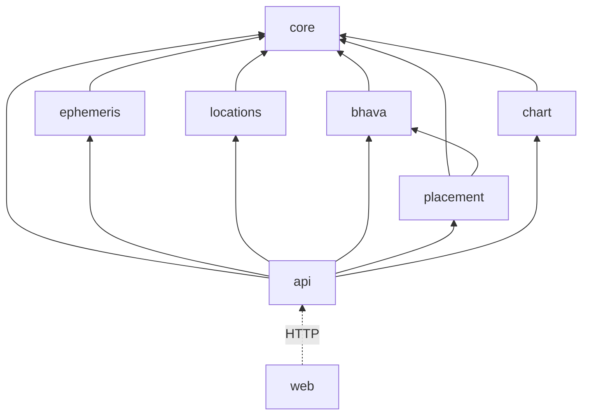

# Modules

The app is split into modules under `modules/<name>/`. Each module has a `module.toml` manifest that declares
exactly which other modules it depends on. A module may import another module's package (`kundli_<name>`) only
if its manifest declares that module, and a module that uses two others must declare both, even when one
already depends on the other. `tools/check_modules.py` enforces this in CI (see [the rules](#the-dependency-rule)).

## Current modules

This block is generated from the manifests. Do not edit it by hand; run `uv run python tools/check_modules.py --write`.

<!-- BEGIN GENERATED: module graph (python tools/check_modules.py --write) -->

_No modules yet._

<!-- END GENERATED: module graph -->

## Planned modules and public interfaces

Modules are built in this order, each in its own worktree and pull request. A module's section moves from
"planned" to "built" when its PR is merged.

| Order | Module | Depends on | Purpose | Status |
|---|---|---|---|---|
| 1 | `core` | — | Shared data models, constants, reference data tables, label and palette data | planned |
| 2 | `ephemeris` | core | pyswisseph wrapper: sidereal longitudes, Lagna, ayanamsa | planned |
| 3 | `locations` | core | Place search in `data/locations.db`, timezone lookup, local time → UT | planned |
| 4 | `bhava` | core | Whole-sign and chalit (equal, Lagna as madhya) bhava numbers | planned |
| 5 | `chart` | core | South Indian SVG chart | planned |
| 6 | `placement` | core, bhava | Rule tables and the placement engine | planned |
| 7 | `api` | core, ephemeris, locations, bhava, placement, chart | FastAPI service composing the modules | planned |
| 8 | `web` | — (HTTP: api) | Input form, chart and placement table | planned |



### core (planned)
Standard library only.
- Enums `Graha` (SURYA … KETU), `Rasi` (1–12), `Nakshatra` (1–27).
- Frozen dataclasses `GeoPoint`, `Place`, `BirthMoment`, `AyanamsaValue`, `BodyPosition`, `ChartPositions`.
- `norm360`, `rasi_of`, `deg_in_rasi`, `nakshatra_pada`, `to_dms(truncate=True)`, `count_from`.
- Data: `rasis.toml`, `nakshatras.toml`, `grahas.toml`, `labels.toml` (en/ta/sa), `palette.toml`.
- `mdtables.read_table(path, section, index)` for checking data tables against `docs/reference/`.

### ephemeris (planned)
- `list_ayanamsas()`, `ayanamsa(jd_ut, option_id) -> AyanamsaValue` (the only place the sidereal mode is set).
- `jd_from_utc(utc)`, `compute_positions(moment, geo, option_id) -> ChartPositions`.

### locations (planned)
- `search(query, limit)`, `get(place_id)`, `to_utc(local, tz, fold=None)`.
- `python -m kundli_locations.derive_tz` writes `data/locations_tz.csv`.

### bhava (planned)
- `whole_sign(lagna, lon)`, `chalit_madhyas(lagna)`, `chalit_sandhis(lagna)`, `chalit(lagna, lon)`, `assign(chart)`.

### chart (planned)
- `render_south_indian(chart, info, lang) -> str` (SVG).

### placement (planned)
- `build_table(chart) -> PlacementTable`, driven by the rule tables in `rules/*.toml`.

### api (planned)
- `GET /api/health`, `GET /api/places?q=`, `GET /api/ayanamsas`, `GET /api/labels?lang=`, `POST /api/chart`,
  `GET /theme.css`, and the web module's static files.

### web (planned)
- Static `index.html`, `app.js`, `styles.css` and fonts, served by the api; talks to it over HTTP only.

## The dependency rule

`uv run python tools/check_modules.py` fails when:
1. a manifest is malformed or names an unknown module;
2. the declared dependencies contain a cycle;
3. Python code in a module, including its tests, imports a `kundli_*` package its manifest does not declare;
4. a module's `pyproject.toml` `kundli-*` dependencies differ from its manifest, or lack a workspace source;
5. web code imports a file outside `modules/web`, a bare package, or a file from another origin;
6. the generated block above is out of date.

Manifest format (`modules/<name>/module.toml`):

```toml
name = "placement"              # must equal the directory name
kind = "python"                 # "python" or "web"
package = "kundli_placement"    # python modules only: kundli_<name>
depends_on = ["core", "bhava"]  # every module whose package this module imports
http_depends_on = []            # web only: modules it calls over HTTP
description = "Rule tables and the placement engine"   # optional
```
