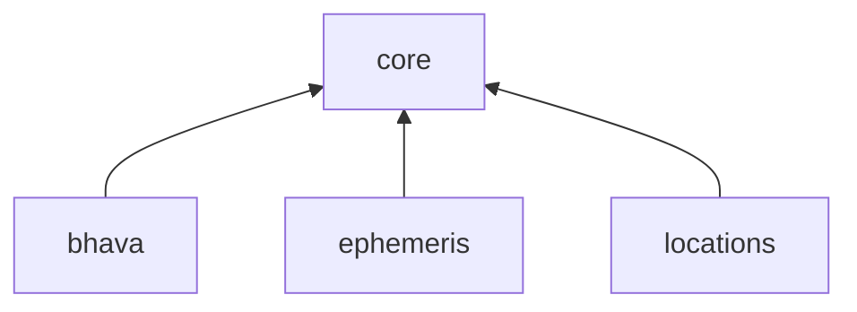
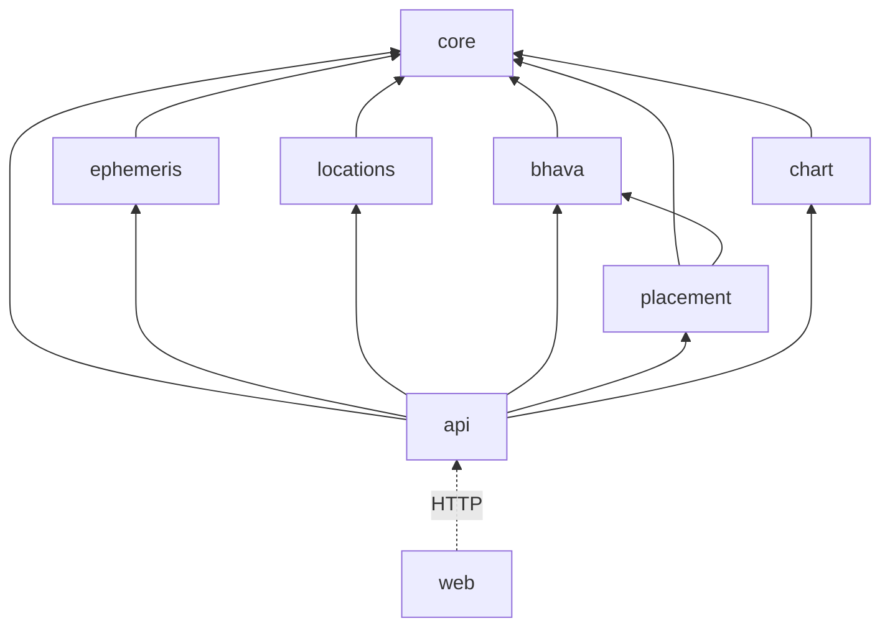

# Modules

The app is split into modules under `modules/<name>/`. Each module has a `module.toml` manifest that declares
exactly which other modules it depends on. A module may import another module's package (`kundli_<name>`) only
if its manifest declares that module, and a module that uses two others must declare both, even when one
already depends on the other. `tools/check_modules.py` enforces this in CI (see [the rules](#the-dependency-rule)).

## Current modules

This block is generated from the manifests. Do not edit it by hand; run `uv run python tools/check_modules.py --write`.

<!-- BEGIN GENERATED: module graph (python tools/check_modules.py --write) -->

| Module | Kind | Depends on (imports) | Talks to over HTTP |
|---|---|---|---|
| `core` | python | — | — |
| `bhava` | python | `core` | — |
| `ephemeris` | python | `core` | — |
| `locations` | python | `core` | — |



<!-- END GENERATED: module graph -->

## Planned modules and public interfaces

Modules are built in this order, each in its own worktree and pull request. A module's section moves from
"planned" to "built" in the PR that builds it.

| Order | Module | Depends on | Purpose | Status |
|---|---|---|---|---|
| 1 | `core` | — | Shared data models, constants, reference data tables, label and palette data | built |
| 2 | `ephemeris` | core | pyswisseph wrapper: sidereal longitudes, Lagna, ayanamsa | built |
| 3 | `locations` | core | Place search in `data/locations.db`, timezone lookup, local time → UT | built |
| 4 | `bhava` | core | Whole-sign and chalit (equal, Lagna as madhya) bhava numbers | built |
| 5 | `chart` | core | South Indian SVG chart | planned |
| 6 | `placement` | core, bhava | Rule tables and the placement engine | planned |
| 7 | `api` | core, ephemeris, locations, bhava, placement, chart | FastAPI service composing the modules | planned |
| 8 | `web` | — (HTTP: api) | Input form, chart and placement table | planned |



### core (built)
Standard library only. Import from `kundli_core`.
- Enums `Graha` (SURYA … KETU), `Rasi` (MESHA=1 … MEENA=12), `Nakshatra` (ASHWINI=1 … REVATI=27);
  `SEVEN_GRAHAS` (the only sign lords), `NODES`.
- Frozen models `GeoPoint(lat, lon)`, `Place`, `BirthMoment(local, tz, utc)`, `AyanamsaValue(option, name, degrees)`,
  `BodyPosition(longitude, speed, retrograde)`, `ChartPositions(moment, geo, jd_ut, ayanamsa, lagna, grahas)`.
- Longitudes (all on one quantised arc-second value; ranges [start, end); display truncates, CONVENTIONS C5):
  `norm360`, `to_arcsec`, `rasi_of`, `deg_in_rasi`, `nakshatra_pada`, `position(lon) -> RasiPosition`,
  `to_dms(deg) -> DMS`, `count_from(start, target)`, `angular_distance(a, b)`.
- Reference data: `rasi_info`, `sign_lord`, `nakshatra_info`, `graha_info`, `retrograde_mark`, `load_table(name)`;
  tables in `kundli_core/data/*.toml`, each checked against its source section.
- Labels: `labels(lang)`, `label(key, lang)`, `LANGUAGES = ("en", "ta", "sa")`; keys like `"rasi.MESHA"`.
- Palette: `palette() -> Palette` (colours, decorative-only colours, allowed text pairs), `contrast_ratio(fg, bg)`.
- Reference checking: `kundli_core.mdtables.read_table(path, heading, index)`, `section_text(...)`;
  `kundli_core.refcheck.verify(table, repo_root)` returns the differences between a data table and its source.

### ephemeris (built)
Depends on core and pyswisseph 2.10.3.2 (AGPL-3.0). Import from `kundli_ephemeris`.
- `list_ayanamsas()`, `get_option(id)`, `DEFAULT_AYANAMSA = "lahiri"`; options are data in `ayanamsas.toml`
  (lahiri, raman, kp_old, kp_new); a new option needs no code change.
- `ayanamsa(jd_ut, option_id) -> AyanamsaValue`: the value including nutation, which is what the positions
  subtract (CONVENTIONS C10). It is the only place an ayanamsa option is applied.
- `jd_from_utc(utc) -> float` (UT1), `compute_positions(moment, geo, option_id) -> ChartPositions`: apparent
  geocentric sidereal longitudes from the bundled Swiss Ephemeris files (1800–2399 CE), mean node, Ketu = Rahu + 180°,
  sidereal Lagna (the rising point).
- Errors: `EphemerisError`, `EphemerisFilesMissing` (raised instead of a Moshier fallback), `UnknownAyanamsa`.
- `configure(ephe_path)` points at other data files.

### locations (built)
Depends on core; standard library at run time (sqlite3, zoneinfo with the OS tzdata). Import from `kundli_locations`.
- `LocationStore(db, tz_csv, overrides_csv)`, `default_store()` (paths from `KUNDLI_LOCATIONS_DB`,
  `KUNDLI_LOCATIONS_TZ`, `KUNDLI_LOCATIONS_TZ_OVERRIDES`, or `data/`); `search(query, limit) -> list[Place]`
  (prefix match on every word, case- and accent-insensitive), `get(place_id) -> Place`.
- `to_utc(local, tz, fold=None)`, `utc_offset(...)`, `make_moment(local, place, fold=None) -> BirthMoment`.
- Errors: `UnknownPlace`, `PlaceNotUsable`, `UnknownTimezone`, `NonexistentLocalTime` (gap), `AmbiguousLocalTime`
  (overlap; pass `fold=0` or `1`).
- `python -m kundli_locations.derive_tz [--check]` (extra `derive`: timezonefinder) regenerates `data/locations_tz.csv`.

### bhava (built)
Depends on core. Import from `kundli_bhava`.
- `whole_sign(lagna, lon) -> int`, `chalit(lagna, lon) -> int` (equal bhavas, Lagna as madhya; a point on a sandhi
  goes to the later bhava), `chalit_madhyas(lagna)`, `chalit_sandhis(lagna)`.
- `placement(lagna, lon) -> BhavaPlacement(whole_sign, chalit, differs)`, `assign(chart) -> {Graha: BhavaPlacement}`.
- The method's numbers and source phrases are data in `methods.toml`.

### chart (planned)
- `render_south_indian(chart, info, lang) -> str` (SVG).

### placement (planned)
- `build_table(chart) -> PlacementTable`, driven by the rule tables in `rules/*.toml`.

### api (planned)
- `GET /api/health`, `GET /api/places?q=`, `GET /api/ayanamsas`, `GET /api/labels?lang=`, `POST /api/chart`,
  `GET /theme.css`, and the web module's static files.

### web (planned)
- Static `index.html`, `app.js`, `styles.css` and fonts, served by the api; talks to it over HTTP only.

## The dependency rule

`uv run python tools/check_modules.py` fails when:
1. a manifest is malformed or names an unknown module;
2. the declared dependencies contain a cycle;
3. Python code in a module, including its tests, imports a `kundli_*` package its manifest does not declare;
4. a module's `pyproject.toml` `kundli-*` dependencies differ from its manifest, or lack a workspace source;
5. web code imports a file outside `modules/web`, a bare package, or a file from another origin;
6. the generated block above is out of date.

Manifest format (`modules/<name>/module.toml`):

```toml
name = "placement"              # must equal the directory name
kind = "python"                 # "python" or "web"
package = "kundli_placement"    # python modules only: kundli_<name>
depends_on = ["core", "bhava"]  # every module whose package this module imports
http_depends_on = []            # web only: modules it calls over HTTP
description = "Rule tables and the placement engine"   # optional
```
