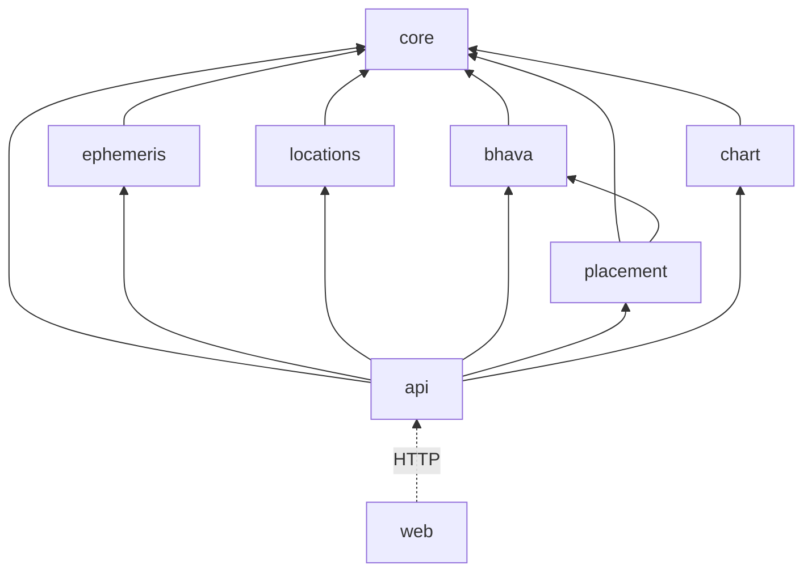

# Modules

The app is split into modules under `modules/<name>/`. Each module has a `module.toml` manifest that declares
exactly which other modules it depends on. A module may import another module's package (`kundli_<name>`) only
if its manifest declares that module, and a module that uses two others must declare both, even when one
already depends on the other. `tools/check_modules.py` enforces this in CI (see [the rules](#the-dependency-rule)).

## Current modules

This block is generated from the manifests. Do not edit it by hand; run `uv run python tools/check_modules.py --write`.

<!-- BEGIN GENERATED: module graph (python tools/check_modules.py --write) -->

| Module | Kind | Depends on (imports) | Talks to over HTTP |
|---|---|---|---|
| `core` | python | — | — |
| `web` | web | — | `api` |
| `bhava` | python | `core` | — |
| `chart` | python | `core` | — |
| `ephemeris` | python | `core` | — |
| `locations` | python | `core` | — |
| `placement` | python | `core`, `bhava` | — |
| `api` | python | `core`, `ephemeris`, `locations`, `bhava`, `placement`, `chart` | — |


<!-- END GENERATED: module graph -->

## Modules and public interfaces

Modules are built in this order, each in its own worktree and pull request. A module's section moves from
"planned" to "built" in the PR that builds it.

| Order | Module | Depends on | Purpose | Status |
|---|---|---|---|---|
| 1 | `core` | — | Shared data models, constants, reference data tables, label and palette data | built |
| 2 | `ephemeris` | core | pyswisseph wrapper: sidereal longitudes, Lagna, ayanamsa | built |
| 3 | `locations` | core | Place search in `data/locations.db`, timezone lookup, local time → UT | built |
| 4 | `bhava` | core | Whole-sign and chalit (equal, Lagna as madhya) bhava numbers | built |
| 5 | `chart` | core | South Indian SVG chart | built |
| 6 | `placement` | core, bhava | Rule tables and the placement engine | built |
| 7 | `api` | core, ephemeris, locations, bhava, placement, chart | FastAPI service composing the modules | built |
| 8 | `web` | — (HTTP: api) | Input form, chart and placement table | built |



### core (built)
Standard library only. Import from `kundli_core`.
- Enums `Graha` (SURYA … KETU), `Rasi` (MESHA=1 … MEENA=12), `Nakshatra` (ASHWINI=1 … REVATI=27);
  `SEVEN_GRAHAS` (the only sign lords), `NODES`.
- Frozen models `GeoPoint(lat, lon)`, `Place`, `BirthMoment(local, tz, utc)`, `AyanamsaValue(option, name, degrees)`,
  `BodyPosition(longitude, speed, retrograde)`, `ChartPositions(moment, geo, jd_ut, ayanamsa, lagna, grahas)`.
- Longitudes (all on one quantised arc-second value; ranges [start, end); display truncates, CONVENTIONS C5):
  `norm360`, `to_arcsec`, `rasi_of`, `deg_in_rasi`, `nakshatra_pada`, `position(lon) -> RasiPosition`,
  `to_dms(deg) -> DMS`, `count_from(start, target)`, `angular_distance(a, b)`.
- Reference data: `rasi_info`, `sign_lord`, `nakshatra_info`, `graha_info`, `retrograde_mark`, `load_table(name)`;
  tables in `kundli_core/data/*.toml`, each checked against its source section.
- Labels: `labels(lang)`, `label(key, lang)`, `LANGUAGES = ("en", "ta", "sa")`; keys like `"rasi.MESHA"`.
- Palette: `palette() -> Palette` (colours, decorative-only colours, allowed text pairs), `contrast_ratio(fg, bg)`.
- Reference checking: `kundli_core.mdtables.read_table(path, heading, index)`, `section_text(...)`;
  `kundli_core.refcheck.verify(table, repo_root)` returns the differences between a data table and its source.

### ephemeris (built)
Depends on core and pyswisseph 2.10.3.2 (AGPL-3.0). Import from `kundli_ephemeris`.
- `list_ayanamsas()`, `get_option(id)`, `DEFAULT_AYANAMSA = "lahiri"`; options are data in `ayanamsas.toml`
  (lahiri, raman, kp_old, kp_new); a new option needs no code change.
- `ayanamsa(jd_ut, option_id) -> AyanamsaValue`: the value including nutation, which is what the positions
  subtract (CONVENTIONS C10). It is the only place an ayanamsa option is applied.
- `jd_from_utc(utc) -> float` (UT1), `compute_positions(moment, geo, option_id) -> ChartPositions`: apparent
  geocentric sidereal longitudes from the bundled Swiss Ephemeris files (1800–2399 CE), mean node, Ketu = Rahu + 180°,
  sidereal Lagna (the rising point).
- Errors: `EphemerisError`, `EphemerisFilesMissing` (raised instead of a Moshier fallback), `UnknownAyanamsa`.
- `configure(ephe_path)` points at other data files.

### locations (built)
Depends on core; standard library at run time (sqlite3, zoneinfo with the OS tzdata). Import from `kundli_locations`.
- `LocationStore(db, tz_csv, overrides_csv)`, `default_store()` (paths from `KUNDLI_LOCATIONS_DB`,
  `KUNDLI_LOCATIONS_TZ`, `KUNDLI_LOCATIONS_TZ_OVERRIDES`, or `data/`); `search(query, limit) -> list[Place]`
  (prefix match on every word, case- and accent-insensitive), `get(place_id) -> Place`.
- `to_utc(local, tz, fold=None)`, `utc_offset(...)`, `make_moment(local, place, fold=None) -> BirthMoment`.
- Errors: `UnknownPlace`, `PlaceNotUsable`, `UnknownTimezone`, `NonexistentLocalTime` (gap), `AmbiguousLocalTime`
  (overlap; pass `fold=0` or `1`).
- `python -m kundli_locations.derive_tz [--check]` (extra `derive`: timezonefinder) regenerates `data/locations_tz.csv`.

### bhava (built)
Depends on core. Import from `kundli_bhava`.
- `whole_sign(lagna, lon) -> int`, `chalit(lagna, lon) -> int` (equal bhavas, Lagna as madhya; a point on a sandhi
  goes to the later bhava), `chalit_madhyas(lagna)`, `chalit_sandhis(lagna)`.
- `placement(lagna, lon) -> BhavaPlacement(whole_sign, chalit, differs)`, `assign(chart) -> {Graha: BhavaPlacement}`.
- The method's numbers and source phrases are data in `methods.toml`.

### chart (built)
Depends on core. Import from `kundli_chart`.
- `render_south_indian(chart, ChartInfo(name, place), lang="en") -> str`: a self-contained SVG (760 × 760 viewBox).
  The fixed sign grid comes from `layout.toml`, checked against horoscope_signs_houses §1.3. The Lagna box is filled
  turmeric with the diagonal mark and the Lagna degree. Grahas show degree and minute (truncated) and the retrograde
  mark, in longitude order; more than 5 entries in a box are written in two columns. The centre shows name, date, time
  (with UTC offset), place and ayanamsa (name and DMS). The border is a kolam chain with lotus corner motifs.
- Every `<text>` carries `data-fg`/`data-bg` palette names; the tests check each against the declared contrast pairs.
- `GRID`, `CELL_OF` expose the layout.

### placement (built)
Depends on core and bhava. Import from `kundli_placement`.
- Rule tables in `kundli_placement/rules/*.toml`, each with its source section, verbatim source cells and the
  CONVENTIONS entries it applies: `uccha_neecha`, `moolatrikona`, `own_signs`, `sign_portions`, `naisargika_maitri`,
  `combustion`, `bhava_categories`, `dignity_precedence`. `rules()` loads them; `load_rule_table(name)` gives the raw table.
- `build_table(chart) -> PlacementTable(lagna: LagnaRow, rows: 9 × PlacementRow)`. Each row has the rasi, degree (DMS),
  nakshatra and pada, retrograde, combust and distance from the Sun, bhava (whole sign and chalit) and whether they
  differ, categories for both, dignity, the relationship to the sign lord, the bhavas it rules, and the dispositor and
  its bhavas. Codes are language-neutral.
- Building blocks: `dignity(graha, lon)`, `kshetra(graha, lord)`, `combustion(graha, lon, retro, sun_lon)`,
  `categories(bhava)`, `lordships(lagna)`.

### api (built)
Depends on core, ephemeris, locations, bhava, placement, chart; FastAPI. Run: `uv run uvicorn kundli_api.app:app`.
- `GET /api/health`, `GET /api/places?q=&limit=`, `GET /api/ayanamsas`, `GET /api/labels?lang=en|ta|sa`.
- `POST /api/chart` with `{name, date: "YYYY-MM-DD", time: "HH:MM[:SS]", place_id, ayanamsa?, lang?, fold?}` returns
  the input, the birth moment (local, tz, UTC, offset, JD), the ayanamsa (name, degrees, DMS), the chalit method, the
  Lagna row, 9 placement rows (codes, not labels), warnings, and the chart SVG.
- Errors never guess: 400 `nonexistent_time` (with the two offsets) or `ambiguous_time` (with `fold` choices),
  404 `unknown_place`, 422 `place_not_usable`, `date_out_of_range` or invalid input.
- `GET /theme.css`: the palette as CSS custom properties. The web module's `static/` is served at `/`
  (`KUNDLI_WEB_DIR` overrides the path); `/api/docs` is the OpenAPI page.
- `create_app(store=None, web_dir=None)` builds the app (tests use it).

### web (built)
Static files in `modules/web/static/`, served by the api at `/`; talks to it over HTTP only (no imports, no build
step, no package dependencies).
- `index.html`: birth form (name, date, time, place search, ayanamsa), language switch (English / தமிழ் / संस्कृतम्),
  the chart, and the placement table below it.
- `render.js`: DOM-free functions that turn API data and labels into HTML (unit-tested with `node --test`).
- `app.js`: the page logic; asks the user to choose when a local time is ambiguous; re-renders on language change.
- `styles.css`: the mangalakara look from `/theme.css` (the core palette), self-hosted Noto Serif fonts
  (`fonts/`, OFL), and a print stylesheet for A4 (chart and table only).

## The dependency rule

`uv run python tools/check_modules.py` fails when:
1. a manifest is malformed or names an unknown module;
2. the declared dependencies contain a cycle;
3. Python code in a module, including its tests, imports a `kundli_*` package its manifest does not declare;
4. a module's `pyproject.toml` `kundli-*` dependencies differ from its manifest, or lack a workspace source;
5. web code imports a file outside `modules/web`, a bare package, or a file from another origin;
6. the generated block above is out of date.

Manifest format (`modules/<name>/module.toml`):

```toml
name = "placement"              # must equal the directory name
kind = "python"                 # "python" or "web"
package = "kundli_placement"    # python modules only: kundli_<name>
depends_on = ["core", "bhava"]  # every module whose package this module imports
http_depends_on = []            # web only: modules it calls over HTTP
description = "Rule tables and the placement engine"   # optional
```
